# Avatar Gateway

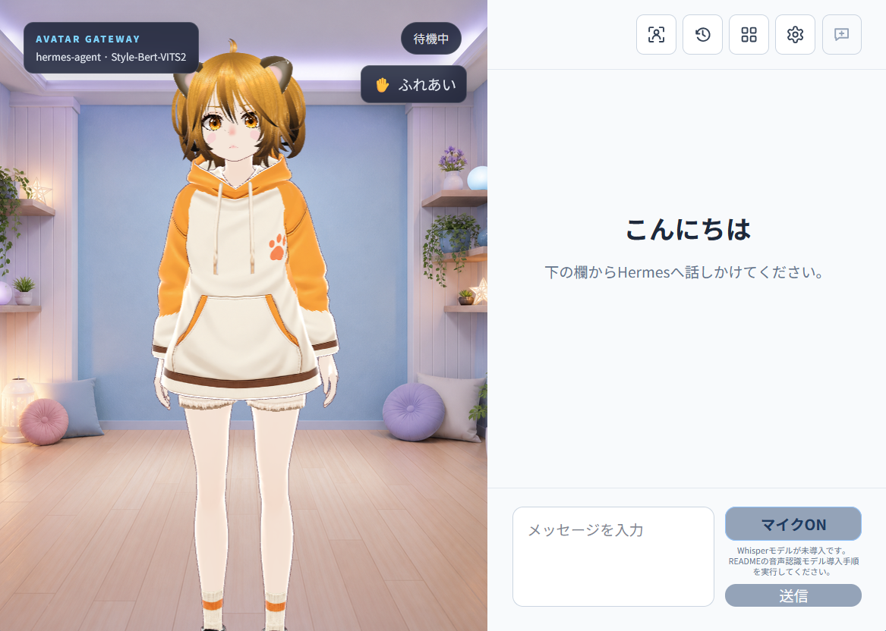

[日本語](README.md)

Avatar Gateway is a local conversation application that presents replies from HermesAgent through a VRM avatar, facial expressions, lip sync, and optional speech. The initial release focuses on conversations between one person and one AI in Firefox or a Chromium-based browser. It is distributed as source code for users who can install and operate Hermes Agent and its related services.

> New here? Start with the [Quick Start](QUICKSTART.en.md). It explains only what you need for your first conversation and defines technical terms as they appear.

The application interface supports Japanese and English. Japanese is the default; you can change the display language in UI Settings.

## Table of Contents

- [Features](#features)
    - [Added Features (Chronological)](#added-features)
- [Requirements](#requirements)
- [1. Initial Configuration](#1-initial-configuration)
- [2. Prepare the Frontend](#2-prepare-the-frontend)
- [3. Start the Backend](#3-start-the-backend)
- [4. Your First Conversation](#4-your-first-conversation)
    - [Conversation and Standard Views](#conversation-and-standard-views)
- [Basic Operations](#basic-operations)
    - [Task Progress and Approval](#task-progress-and-approval)
    - [Stopping Speech or the Entire Task](#stopping-speech-or-the-entire-task)
    - [Starting a New Session](#starting-a-new-session)
    - [Viewing Saved Conversations](#viewing-saved-conversations)
    - [Reconnecting to Active Work](#reconnecting-to-active-work)
- [Optional Features and Settings](#optional-features-and-settings)
    - [Speech Output (Optional)](#speech-output-optional)
        - [Set Up Style-Bert-VITS2](#set-up-style-bert-vits2)
            - [Voice for Hamuko](#voice-for-hamuko)
            - [Style-Bert-VITS2 for RTX 50 Series (Optional)](#style-bert-vits2-for-rtx-50-series-optional)
        - [OpenAI-Compatible Speech Output](#openai-compatible-speech-output)
    - [Microphone Input (Optional)](#microphone-input-optional)
        - [Set Up faster-whisper](#set-up-faster-whisper)
        - [OpenAI-Compatible Microphone Input](#openai-compatible-microphone-input)
        - [Run Speech Recognition on a GPU](#run-speech-recognition-on-a-gpu)
        - [Change the Speech Recognition Model](#change-the-speech-recognition-model)
    - [Screen Sharing and Image Attachments (Optional)](#screen-sharing-and-image-attachments-optional)
    - [Switching the LLM Model (Optional)](#switching-the-llm-model-optional)
    - [UI Settings (Optional)](#ui-settings-optional)
        - [Changing the Display Language](#changing-the-display-language)
        - [Adding a Translation](#adding-a-translation)
        - [Saving the Starting Camera View](#saving-the-starting-camera-view)
        - [Showing the Camera Controls Guide](#showing-the-camera-controls-guide)
        - [Background Images](#background-images)
        - [Adjusting Audio](#adjusting-audio)
        - [Showing Motion Preview Buttons](#showing-motion-preview-buttons)
        - [Interacting with the Avatar](#interacting-with-the-avatar)
            - [Responsive Regions](#responsive-regions)
        - [Adjusting Hit Areas](#adjusting-hit-areas)
        - [Face and Gaze Detection](#face-and-gaze-detection)
        - [Saving and Resetting Settings](#saving-and-resetting-settings)
    - [Change the VRM (Optional)](#change-the-vrm-optional)
    - [Previewing VRMA Motions (Optional)](#previewing-vrma-motions-optional)
    - [Editing the Motion Catalog (Optional)](#editing-the-motion-catalog-optional)
    - [Camera Controls (Optional)](#camera-controls-optional)
    - [Generated Images and 90-Day Retention (Optional)](#generated-images-and-90-day-retention-optional)
    - [Date and Time Context for Conversations (Optional)](#date-and-time-context-for-conversations-optional)
    - [Viewing Hermes Skills and Toolsets (Optional)](#viewing-hermes-skills-and-toolsets-optional)
    - [Use from Another Device on the LAN (Optional)](#use-from-another-device-on-the-lan-optional)
    - [Use Another Hermes Profile (Optional)](#use-another-hermes-profile-optional)
    - [Start the Development Frontend (Optional)](#start-the-development-frontend-optional)
- [Troubleshooting](#troubleshooting)
    - [Cannot Connect to Hermes](#cannot-connect-to-hermes)
    - [Skill list API error: 502 in the Resources Screen](#skill-list-api-error-502-in-the-resources-screen)
    - [Text Works but Speech Does Not](#text-works-but-speech-does-not)
    - [The VRM Is Not Displayed](#the-vrm-is-not-displayed)
    - [The Microphone Cannot Be Enabled](#the-microphone-cannot-be-enabled)
    - [Using the Microphone over HTTP on a LAN](#using-the-microphone-over-http-on-a-lan)
        - [Shared Chromium Settings for Microphone and Screen Sharing](#shared-chromium-settings-for-microphone-and-screen-sharing)
        - [Firefox Microphone Settings](#firefox-microphone-settings)
    - [Using Firefox Screen Sharing over HTTP on a LAN](#using-firefox-screen-sharing-over-http-on-a-lan)
    - [No Speech Audio in Firefox](#no-speech-audio-in-firefox)
- [Security](#security)
- [Major Open-Source Software](#major-open-source-software)
- [Licenses](#licenses)

## Features

- Use Hermes conversations and tasks through a VRM avatar
- See replies as they are generated, including task progress and approval requests
- Use optional Japanese speech with Style-Bert-VITS2
- Use optional Japanese microphone input with faster-whisper
- Stop speech alone, or stop the entire Hermes task
- Reconnect to active work after reloading the page
- View Hermes Skills and Toolsets
- View, branch, and delete saved conversations
- Display images generated by Hermes
- Use VRM expressions, lip sync, idle movement, and motions
- Adjust the camera and background, and interact with the avatar
- Use webcam-based [face and gaze detection](#face-and-gaze-detection) for face following, gestures, and spoken messages
- Continue with text-only conversations when voice features are disabled
- [Screen sharing and image attachments](#screen-sharing-and-image-attachments-optional) for questions about what you see

### Added Features

- [Face and gaze detection](#face-and-gaze-detection)
- [OpenAI-compatible speech output](#openai-compatible-speech-output) and [speech recognition](#openai-compatible-microphone-input)
- [LLM model selection](#switching-the-llm-model-optional)
- [Japanese and English interface](#changing-the-display-language)
- [Screen sharing and image attachments](#screen-sharing-and-image-attachments-optional)

## Requirements

- Python 3.11 or later
- Node.js 20 or later
- HermesAgent API Server

Voice services and a replacement VRM are optional; see [Optional Features and Settings](#optional-features-and-settings).

Hermes is expected to run with these settings:

```env
API_SERVER_ENABLED=true
API_SERVER_HOST=127.0.0.1
API_SERVER_PORT=8642
API_SERVER_MODEL_NAME=hermes-agent
```

Set `API_SERVER_KEY` to a real secret value and keep it private.

## 1. Initial Configuration

Create the local settings file in the project root:

```bash
cp .env.example .env
```

Open `.env` and configure the default Profile as follows. Set `HERMES_API_KEY` to the same value as the Hermes `API_SERVER_KEY`.

```env
HERMES_BASE_URL=http://127.0.0.1:8642/v1
HERMES_API_KEY=Hermes API_SERVER_KEY
```

Most users can continue with the default Profile. To use another Profile, see [Use Another Hermes Profile (Optional)](#use-another-hermes-profile-optional).

## 2. Prepare the Frontend

The first time you set up Avatar Gateway, install the frontend dependencies and build the browser application:

```bash
cd frontend
npm ci
npm run build
cd ..
```

The build is written to `frontend/dist`, and the backend serves it from the same address as the API. After updating the frontend source code, run `npm run build` again from the `frontend` directory before restarting the backend.

## 3. Start the Backend

```bash
cd backend
python3 -m venv .venv
.venv/bin/pip install -r requirements.txt
.venv/bin/python -m app
```

Leave this terminal running. Open the following address in Firefox or a Chromium-based browser:

```text
http://127.0.0.1:8000
```

To check backend health, run `curl http://127.0.0.1:8000/api/health` in another terminal.

## 4. Your First Conversation

Type a question in the message field and select **Send**. Use `Enter` for a new line or `Ctrl+Enter` (`⌘+Enter` on macOS) to send. In Conversation view, select **Text input** if the field is hidden. When the reply appears, text chat is ready.

The interface starts in Japanese. To use English, select the gear icon (`設定`), find `表示言語 / Language` at the top of Settings, and choose `English`. The instructions below use English labels; existing screenshots may show Japanese. See [Changing the Display Language](#changing-the-display-language) for more details.

### Conversation and Standard Views

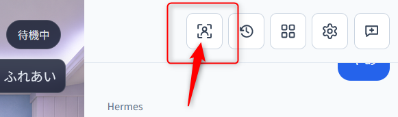

Select the person-in-a-frame icon labeled `Switch to conversation view` to enter Conversation view, which fills the browser with the avatar. It shows only the latest question and reply in outlined subtitle-style text. Microphone controls, stop controls, current task state, errors, and approval requests remain available. Select `Text input` to open the text box. In text input, press `Enter` for a new line or `Ctrl+Enter` (`⌘+Enter` on macOS) to send.

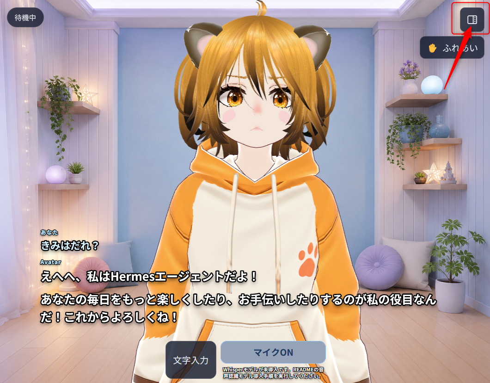

Select the split-screen icon labeled `Switch to standard view` to return to Standard view for full history, sessions, Hermes resources, and settings. Changing views keeps the current session, active conversation, and microphone state.

The Standard view actions are, from left to right: change view, session history, Hermes features, model selection, settings, and new session. Hover over an icon to see its label in the selected display language; assistive technology receives the same label.

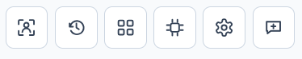

On first use, only a portrait display 1024 pixels wide or narrower starts in Conversation view. Your selection is saved in that browser and is not changed merely by rotating the device. Controls avoid the safe areas used by notches and home indicators.

During a conversation, the upper-left status shows actual stages reported by Hermes, such as thinking, running tools, checking results, and preparing the answer. When tools are used, it also shows the three most recent tool names, their state, and any duration provided by Hermes. Internal reasoning, tool arguments, and tool result bodies are not displayed.

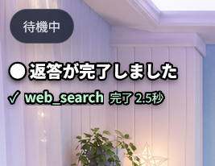

## Basic Operations

### Task Progress and Approval

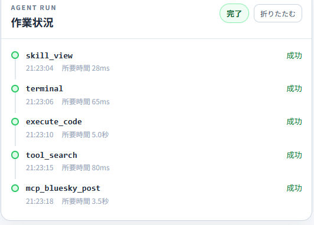

When Hermes uses tools, the conversation area shows tool name, start time, running, success or failure state, and any duration provided by Hermes. Avatar Gateway does not invent tool result text or file diffs that Hermes did not provide.

When Hermes pauses for approval of a risky action, a yellow panel displays its explanation and a command with secrets removed. The choices are:

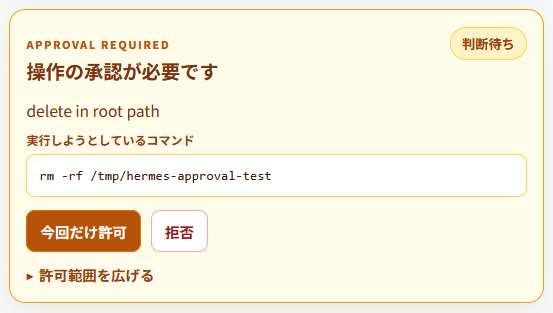

- `Allow once`: allow only the current request; normally choose this
- `Deny`: deny the current request
- `Allow for this session`: allow a broader class of similar actions during this session
- `Always allow`: may affect later Runs and requires an additional confirmation

Buttons are disabled while an approval response is being sent. Resolved or expired requests are marked accordingly.

### Stopping Speech or the Entire Task

While Hermes is generating, audio is being prepared, or speech is playing, two controls are available.

- `Stop speech` stops speech for the current reply without stopping Hermes, tools, approvals, or text generation. Speech is enabled again for the next message.
- The red `Stop task` control stops both the current Hermes task and its speech.

Text already received remains in the conversation. A user-requested stop is not displayed as an audio error.

### Starting a New Session

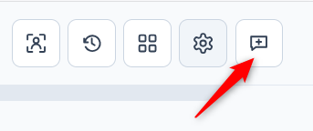

Select the speech-bubble-plus icon labeled `New session`. After confirmation, Avatar Gateway marks the current Hermes session as completed and shows an empty conversation. The session and its messages remain in Hermes history. A new Hermes session is created when the next message is sent.

The action is disabled while Hermes is working, waiting for approval, synthesizing speech, or speaking. If the completion request fails, the current conversation remains visible.

### Viewing Saved Conversations

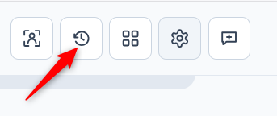

Select the arrow-around-a-clock icon labeled `Session history`. Avatar Gateway lists only sessions that it created, ordered by most recent update. It initially loads 50 entries.

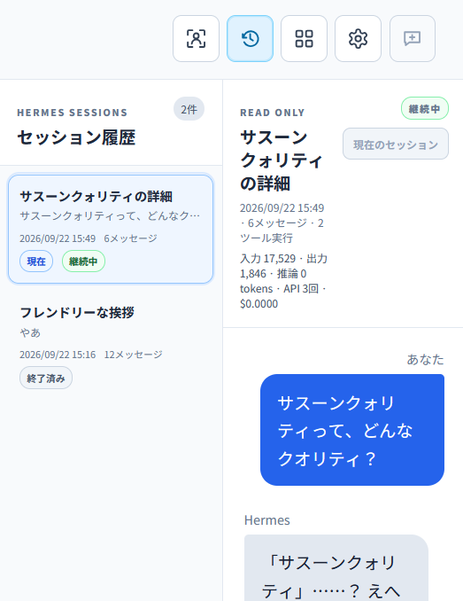

Selecting an entry only previews its official history. It does not change the active destination session. An unfinished session can be reopened after Avatar Gateway refreshes its state. A completed session can be branched into a new child session without modifying the original history.

The details include message count, tool count, input, output and reasoning tokens, API calls, cost when available, and the parent session. Statistics not recorded by Hermes are shown as zero or unknown.

For a completed session that is not currently open, `Delete this history` permanently deletes its conversation history from the Hermes SessionDB after confirmation. This cannot be undone. The backend refuses to delete an active session.

### Reconnecting to Active Work

If the page is reloaded while Hermes is working, running tools, or waiting for approval, Avatar Gateway reconnects to the active task as long as the same backend continues running.

Previously generated audio is not played automatically after reconnecting. If the Avatar Gateway backend itself restarts, some live details and approval buttons may not be recoverable. Saved conversation history is loaded from Hermes. For safety, an approval button is not restored when its details cannot be recovered; the task can still be stopped.

## Optional Features and Settings

Text chat works with the steps above. Choose the features you want to use:

- Voice: [speech output](#speech-output-optional) / [microphone input](#microphone-input-optional)
- Sharing: [screens and images](#screen-sharing-and-image-attachments-optional)
- Conversation: [LLM model](#switching-the-llm-model-optional) / [date and time](#date-and-time-context-for-conversations-optional) / [Skills and Toolsets](#viewing-hermes-skills-and-toolsets-optional)
- Appearance: [UI settings](#ui-settings-optional) / [VRM](#change-the-vrm-optional) / [motion previews](#previewing-vrma-motions-optional) / [motion catalog](#editing-the-motion-catalog-optional) / [camera](#camera-controls-optional)
- Setup: [generated images](#generated-images-and-90-day-retention-optional) / [LAN access](#use-from-another-device-on-the-lan-optional) / [Hermes Profile](#use-another-hermes-profile-optional) / [development frontend](#start-the-development-frontend-optional)

### Speech Output (Optional)

When Style-Bert-VITS2 is enabled, Avatar Gateway begins reading completed sentences without waiting for the entire reply. Commands and detailed tool results remain on screen, while a short result summary is spoken. If one speech segment fails, text display and later speech continue.

`STYLEBERTVITS2_CHUNK_MIN_CHARS` and `STYLEBERTVITS2_CHUNK_MAX_CHARS` control how text is divided for speech. The defaults normally do not need adjustment.

After changing settings, restart the backend and send a message from the screen to try speech output. If Firefox blocks audio, see [autoplay settings](#no-speech-audio-in-firefox).

#### Set Up Style-Bert-VITS2

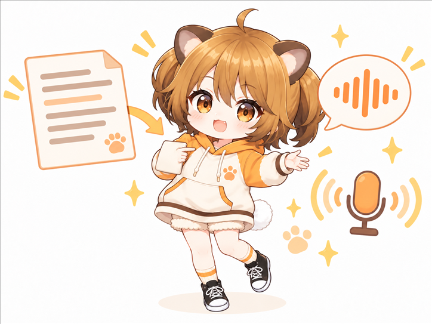

Speech output is disabled in the public configuration example. To use Style-Bert-VITS2, start its server and set `STYLEBERTVITS2_ENABLED=true` in `.env`. Configure the server and voice with these values:

```env
STYLEBERTVITS2_SERVER_URL=http://127.0.0.1:5000
STYLEBERTVITS2_MODEL_ID=0
STYLEBERTVITS2_STYLE=Neutral
STYLEBERTVITS2_SDP_RATIO=0.2
STYLEBERTVITS2_LENGTH=1.0
STYLEBERTVITS2_CHUNK_MIN_CHARS=6
STYLEBERTVITS2_CHUNK_MAX_CHARS=100
```

`CHUNK_MIN_CHARS` joins very short phrases to the following sentence. `CHUNK_MAX_CHARS` limits long text that has no sentence-ending punctuation. The defaults normally work without adjustment.

For text-only use, leave the default unchanged:

```env
STYLEBERTVITS2_ENABLED=false
```

Speech output adds much of the character to this application, so we recommend enabling it if you can.

To use an OpenAI-compatible service instead, see [OpenAI-Compatible Speech Output](#openai-compatible-speech-output).

##### Voice for Hamuko

A free Style-Bert-VITS2 voice model for Hamuko is available on BOOTH: [Hamuko Voice Data for Avatar Gateway](https://kinkuman.booth.pm/items/8885580).

##### Style-Bert-VITS2 for RTX 50 Series (Optional)

If the official Style-Bert-VITS2 setup does not work with an RTX 50 series GPU, you can use the [`codex/rtx5070-support` branch](https://github.com/kinkuman/Style-Bert-VITS2/tree/codex/rtx5070-support), which includes a compatibility patch.

To install without Git, [download the RTX 50 series version as a ZIP](https://github.com/kinkuman/Style-Bert-VITS2/archive/refs/heads/codex/rtx5070-support.zip) and extract it.

If you use Git, clone only that branch:

```bash
git clone --depth 1 \
  --branch codex/rtx5070-support \
  --single-branch \
  https://github.com/kinkuman/Style-Bert-VITS2.git
cd Style-Bert-VITS2
```

After downloading, follow the README in that copy of Style-Bert-VITS2 to install and start it.

#### OpenAI-Compatible Speech Output

Instead of Style-Bert-VITS2, you can use `speech serve` from [speech.cpp](https://github.com/nyosegawa/speech.cpp) or OpenAI's own `POST /v1/audio/speech`. Set the provider to `openai` and configure the endpoint and voice:

```env
STYLEBERTVITS2_ENABLED=true
AVATAR_GATEWAY_TTS_PROVIDER=openai
OPENAI_TTS_BASE_URL=http://127.0.0.1:8080/
OPENAI_TTS_API_KEY=
OPENAI_TTS_MODEL=
OPENAI_TTS_VOICE=none
```

`OPENAI_TTS_BASE_URL` works with or without a trailing `/v1`. For OpenAI itself, use `https://api.openai.com/v1` together with an API key.

`OPENAI_TTS_VOICE` defaults to `none`. While it is `none` or empty, no `voice` member is sent, so for a server that requires one, such as speech.cpp, change it to a real voice name like `ono_anna`. `GET /v1/models` lists the voices a model offers.

An empty `OPENAI_TTS_MODEL` uses whichever synthesis model the server holds. `OPENAI_TTS_SPEED`, `OPENAI_TTS_INSTRUCTIONS`, and `OPENAI_TTS_LANGUAGE` are not sent while empty. speech.cpp refuses members it does not take rather than ignoring them, so set only what your model supports.

### Microphone Input (Optional)

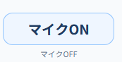

Select `Mic ON` and allow microphone access in the browser. When `Waiting for speech` appears, speak normally. After 0.8 seconds of silence by default, Avatar Gateway ends the recording, transcribes it with the configured speech recognition service, and sends the text to Hermes.

The microphone remains ready for the next utterance until you select `Mic OFF` or close the page. If you begin speaking while the avatar is talking or Hermes is working, Avatar Gateway stops the current task and speech so that the new utterance can take priority.

The browser requests echo cancellation. If speaker audio is detected as your voice, raise the speech-detection sensitivity value in Settings or use headphones. In the `Audio` section of Settings, each browser can save:

- The silence duration used to decide that speech has ended, from 0.6 to 2.0 seconds
- Speech-detection sensitivity; raise the value for noisy rooms and lower it when your voice is not detected

Configure either faster-whisper or an OpenAI-compatible API below. If microphone access is blocked over HTTP on a LAN, see [browser settings](#using-the-microphone-over-http-on-a-lan).

#### Set Up faster-whisper

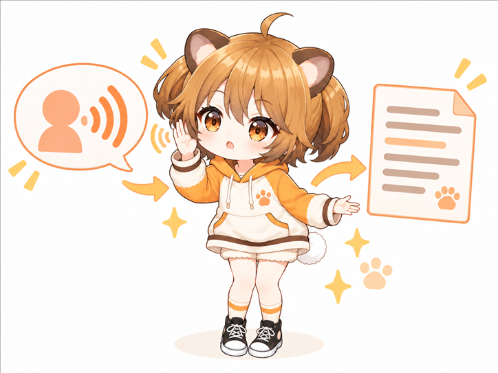

Microphone input is also disabled in the public configuration example. Set `FASTER_WHISPER_ENABLED=true` to enable it. The default configuration uses CPU INT8 processing so that speech recognition does not consume the GPU memory used by the LLM.

```env
FASTER_WHISPER_ENABLED=true
FASTER_WHISPER_MODEL=small
FASTER_WHISPER_DEVICE=cpu
FASTER_WHISPER_COMPUTE_TYPE=int8
FASTER_WHISPER_LANGUAGE=ja
FASTER_WHISPER_CPU_THREADS=8
FASTER_WHISPER_BEAM_SIZE=3
FASTER_WHISPER_LOCAL_FILES_ONLY=true
```

Avatar Gateway never downloads a Whisper model during normal startup. After installing the backend requirements, use the explicit download command below to place the selected model under `local-assets/whisper/`. If the model is missing, only microphone input is disabled; text chat and speech output continue to work.

Stop the backend, then run these commands from the project root. Downloading requires an internet connection. The last command starts the backend again.

```bash
cd backend
.venv/bin/python -m scripts.download_whisper_model
.venv/bin/python -m app
```

The download command shows the model name and destination before downloading. No local model download is needed when using an OpenAI-compatible API.

#### OpenAI-Compatible Microphone Input

Instead of local faster-whisper, you can use [speech.cpp](https://github.com/nyosegawa/speech.cpp) or OpenAI's own `POST /v1/audio/transcriptions`. With `AVATAR_GATEWAY_STT_PROVIDER=openai`, the Whisper model download command is not needed:

```env
FASTER_WHISPER_ENABLED=true
AVATAR_GATEWAY_STT_PROVIDER=openai
OPENAI_STT_BASE_URL=http://127.0.0.1:8080/
OPENAI_STT_API_KEY=
OPENAI_STT_MODEL=
OPENAI_STT_LANGUAGE=ja
OPENAI_STT_RESPONSE_FORMAT=json
```

speech.cpp accepts only WAV, so a browser recording in WebM or MP4 is converted to 16 kHz mono WAV before it is sent. The conversion uses `av`, which ships with `faster-whisper`, so nothing extra has to be installed.

Set `OPENAI_STT_RESPONSE_FORMAT=verbose_json` to also receive the language and duration the server reports. Put proper nouns you want recognized in `OPENAI_STT_PROMPT`, for a model that takes one.

#### Run Speech Recognition on a GPU

Speech recognition uses the CPU by default. To run faster-whisper on an NVIDIA GPU, first follow the [official faster-whisper GPU requirements](https://github.com/SYSTRAN/faster-whisper#gpu) and install the compatible cuBLAS for CUDA 12 and cuDNN 9.

Change the speech recognition settings in `.env`:

```env
FASTER_WHISPER_DEVICE=cuda
FASTER_WHISPER_COMPUTE_TYPE=float16
```

To use less VRAM, you can select `FASTER_WHISPER_COMPUTE_TYPE=int8_float16` instead. If Hermes or another application uses the same GPU, check their combined VRAM usage. If they compete for memory, return to `cpu` and `int8`.

Restart the backend after changing the settings, then try microphone input once. To check the device and compute type actually used when the model loads, start the backend with `CT2_VERBOSE=1` and look for `device cuda:0` in the log.

#### Change the Speech Recognition Model

To use a model other than the default `small`, change the model name in `.env`. For Japanese speech, choose a multilingual model without the `.en` suffix.

| Model | When to use it |
| --- | --- |
| `tiny` | Fastest and lightest, with lower recognition accuracy. |
| `base` | A lightweight choice with better accuracy than `tiny`. |
| `small` | Default balance of speed, accuracy, and resource use. |
| `medium` | Higher accuracy than `small`, with more processing time and resource use. |
| `large-v3` | Prioritizes accuracy and needs substantial VRAM and processing time. |
| `turbo` | Prioritizes speed while retaining accuracy close to larger models. |

For example, to use `medium`, set:

```env
FASTER_WHISPER_MODEL=medium
```

Stop the backend, then run the same model download command again. The download shows its progress:

```bash
cd backend
.venv/bin/python -m scripts.download_whisper_model
```

Start the backend after the download finishes. The model goes to the default location, so no additional path setting is needed. To switch back to another model, change `FASTER_WHISPER_MODEL` and run the same download command again.

### Screen Sharing and Image Attachments (Optional)

In Conversation view, select **＋** in the bottom controls to attach an image or share a screen. The panel stays closed until you open it. Select the small **Sharing** indicator to view the preview or stop sharing. You can also drop an image directly onto Conversation view. A small thumbnail appears only while an attachment is waiting to be sent.

Ask the avatar about a screen or image using the usual message box or microphone. The model connected through Hermes must support image input.

**To share a screen**

1. Select **Share screen** in the conversation composer.
2. In the browser picker, choose a screen, window, or tab. Available options depend on the browser and OS.
3. Check the preview, then send a question or speak into the microphone. Each question includes one image of the screen at the time you send it.
4. Select **Stop sharing** to finish. The browser's own stop button also ends sharing.

Screen sharing requires a connection the browser recognizes as a secure context. HTTPS is recommended when connecting from another PC on a LAN. To use HTTP in Firefox, [register the host as a secure context](#using-firefox-screen-sharing-over-http-on-a-lan). HTTP works on localhost. If capture is unavailable, keep the shared source visible and check that the preview updates.

For Chromium-based browsers, screen sharing uses [the same HTTP exception as microphone access](#using-the-microphone-over-http-on-a-lan). No additional setting is needed if it is already configured.

**To send an image file**

1. Drop one PNG, JPEG, or WebP still image onto the message composer, or select **Attach image**.
2. Check the preview, add a question, and send. Sending an image without text asks “Please tell me about this image.”
3. Select **Remove image** to cancel the attachment. If screen sharing is active, the attached image takes priority for that question. Subsequent questions use the shared screen again.

Files may be up to 10MB. Images are resized to a maximum long edge of 2048px. If the result still exceeds 4MB, choose a smaller image. To ask about small text, enlarge it in the source application before sending.

Avatar Gateway does not persist input images. Previews are held temporarily in the browser; Hermes manages storage and retention after submission. Browsing past images is not supported. Stopping screen sharing prevents screen images from being attached to subsequent questions.

### Switching the LLM Model (Optional)

Select **Switch model**, to the right of **Resources** at the top of the chat, to open the models published by Hermes. Type a name in **Filter models**, then choose a model from the provider you want. Configure that provider's credentials in Hermes first.

Your choice applies from the next message and is saved across Avatar Gateway restarts. Select **Default model** in the same list to return to the default. This control is unavailable if Hermes does not support the model-list API.

### UI Settings (Optional)

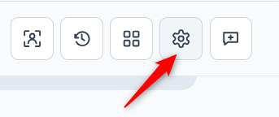

Select the gear icon labeled `Settings` to configure:

- Display language: Japanese, English, or an added translation
- Camera controls, saving the starting view, and returning to automatic framing
- Whether camera instructions are shown over the avatar
- VRM background and fitting mode
- Audio: speech volume, approval speech, and microphone input settings
- Whether motion preview buttons are shown
- Avatar interaction, enabled body regions, and model-specific hit areas
- [Face and gaze detection](#face-and-gaze-detection), including face following and gaze-triggered speech
- Saving and resetting settings: browser overrides and server defaults

#### Changing the Display Language

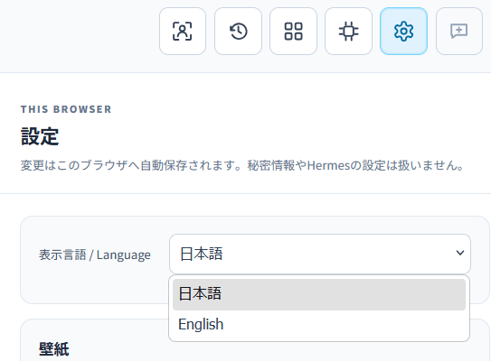

At the top of Settings, use `表示言語 / Language` to choose `日本語` or `English`. Buttons, descriptions, status labels, and fixed application notices switch immediately. The choice is saved in the current browser and remains after reloading the page. The bilingual selector label helps you find the control even if you cannot read the selected language.

Changing the display language does not translate conversation history, change the language Hermes replies in, or rewrite your saved approval speech text. Date and number formatting remains unchanged.

The language priority is:

1. The language selected in this browser.
2. The `language` value in `config/ui.json`, used as the server default.
3. Japanese (`ja`) if no language is specified.

To use your selection as the initial language for new browsers, select `Use current settings as server defaults` at the bottom of Settings and confirm. This saves the other current UI settings too. Existing selections in other browsers are not changed. `Reset browser settings` clears this browser's UI overrides and returns to the server defaults. You do not need a language entry in `.env` or a `config.yaml` file.

#### Adding a Translation

Bundled translations are stored in `assets/locales/ja.json` and `assets/locales/en.json`. These JSON files also contain the text for fixed notices and errors returned by the backend.

As with VRM models and backgrounds, place your own translations under `local-assets/`. For example, run these commands from the Avatar Gateway folder to start an Indonesian translation:

```bash
mkdir -p local-assets/locales
cp assets/locales/en.json local-assets/locales/id.json
```

1. Open `id.json` in a text editor and change `_meta.name` to `Bahasa Indonesia`. This name appears in the language selector.
2. Keep keys such as `settings.title` unchanged and translate the English text on the right. Preserve placeholders such as `{{count}}` and `{{status}}`, along with file paths and configuration names. We recommend keeping the bilingual `表示言語 / Language` text for `settings.language` so the selector stays easy to find.
3. Save valid JSON, then reload the browser page. Select `Bahasa Indonesia` from the language list in Settings. Adding or editing only translation JSON files requires neither a frontend rebuild nor a backend restart.

Additional language files in `assets/locales/` are also recognized. If both directories contain the same language and key, the text in `local-assets/locales/` takes priority. To customize only part of the bundled English translation, create `local-assets/locales/en.json` with `_meta.name` and just the keys you want to replace.

For a partial override of a bundled language, unchanged keys keep their bundled translations. Other missing translations fall back to Japanese. Invalid JSON files are skipped and reported in the backend logs. Entries whose placeholders differ from the Japanese resource are ignored. If a saved language is no longer available, the interface falls back to Japanese.

#### Saving the Starting Camera View

Move, rotate, and zoom the avatar with the mouse or touch, then select `Save current view` under `Camera` in Settings. This saves the starting view. Select `Reset to automatic` to return to the full-body position calculated when the model loaded. See [Camera Controls](#camera-controls-optional) for gestures.

#### Showing the Camera Controls Guide

Under `Display` in Settings, use `Camera controls guide` to show or hide the camera instructions and reset button over the avatar.

#### Background Images


Avatar Gateway includes square backgrounds intended to place a VRM near the center:

- `cozy-streaming-room.png`: bright pastel room
- `japanese-tatami-room.png`: tatami room with shoji and a garden
- `cyber-neon-room.png`: blue-purple near-future room
- `classic-library-room.png`: warm classic study with bookshelves
- `fantasy-sky-room.png`: fantasy sky and clouds
- `green-screen.png`: solid `#00ff00` green screen

The bundled backgrounds are CC0. See the [Bundled Asset Licenses](ASSET_LICENSES.en.md).

Place personal PNG, JPEG, or WebP files under:

```text
local-assets/backgrounds/
```

No backend restart is required. In Settings, select `Reload image list`, then select the filename. A local file with the same name as a bundled background replaces it without modifying the product file.

#### Adjusting Audio

Under `Audio` in Settings, you can adjust:

- Speech volume: set the volume from 0 to 100%.
- Speech when requesting approval: the text read aloud when approval is requested. Leave it empty to disable this speech.
- End-of-speech silence: set how long silence must last before an utterance ends, from 0.6 to 2.0 seconds.
- Speech-detection sensitivity: raise the value if background noise triggers recording, or lower it if your voice is not detected.

See [Microphone Input](#microphone-input-optional) for setup and usage.

#### Showing Motion Preview Buttons

Under `Display` in Settings, use `Motion preview buttons` to show or hide the buttons for manually checking VRMA files. Keep them hidden during normal use and enable them when needed. See [Previewing VRMA Motions](#previewing-vrma-motions-optional) for usage.

#### Interacting with the Avatar

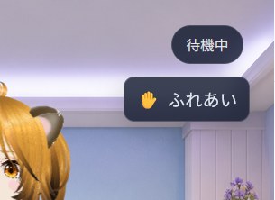

Select `Touch` on the avatar screen to switch from camera controls to interaction mode. You can instead hold the Space key outside the text field to enable it temporarily.

##### Responsive Regions

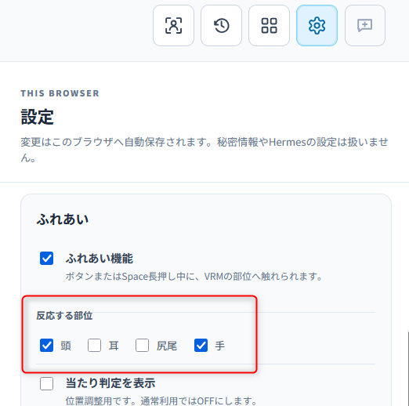

The head and hands respond by default. Ears and tail can be enabled in Settings. Clicking or tapping a region produces a physical reaction, and repeated touches are grouped and reported with their count. Dragging across a region is treated as stroking; the body part follows slightly and returns when released.

`Test recoil only` is a debugging feature retained for testing avatar reactions. Leave it off during normal use.

New interactions are not sent while Hermes is responding, running a tool, waiting for approval, or processing audio. Draft text in the normal input field is preserved.

Settings can disable individual regions. Ears and tail are off by default.

#### Adjusting Hit Areas

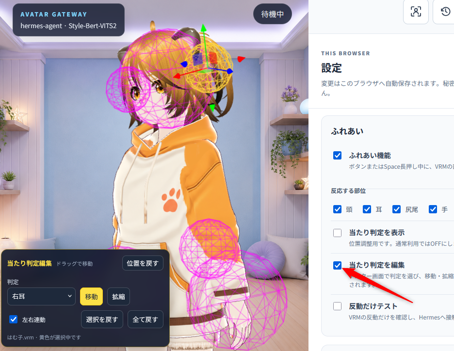

If a model does not match the interaction areas, use the hit-area display and editor to adjust them. Changes are saved per VRM filename and can also be saved as the server defaults.

#### Face and Gaze Detection

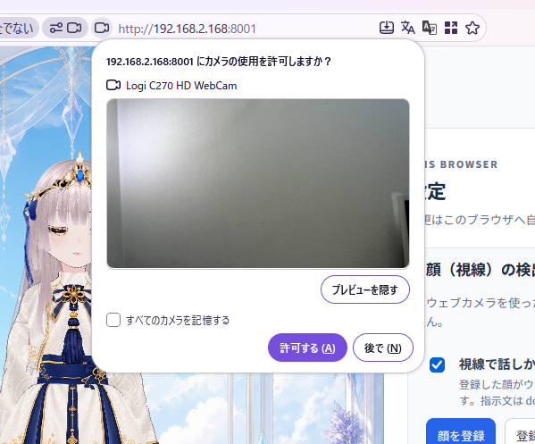

In Settings, open `Face and gaze detection` to enable webcam features. `Speak when you look at the camera` and `Follow face position` are off by default. Allow camera access when your browser asks.

- **Follow face position**: Turns the avatar's eyes and face toward a face in the webcam image. If a face is registered, only that person is followed. Otherwise, the largest visible face is followed. This feature alone requires no additional Hermes setup.
- **Speak when you look at the camera**: Select `Register face` to register your face, then enable this option. When the registered face turns toward the camera, the avatar reads prepared messages aloud. If there is no message to read, it performs a short gesture.
- **Improve face detection visibility**: Use this when faces are difficult to detect in low light. It adjusts the brightness and other detection settings for the image used for detection.
- **Sync gaze-triggered speech to messages**: Sends the spoken content to Hermes together with your next message so the conversation can continue from it.

Reading prepared messages requires speech output to be configured, along with a dedicated Skill and cron job in Hermes. Open [Instructions to send to Hermes](docs/gaze_speech_hermes.md) (in Japanese) and send the supplied instructions to Hermes's own chat to set them up. Only new output generated after Avatar Gateway starts is eligible to be read aloud.

Camera images are not saved. The registered face's features are stored in the current browser. `Reset browser settings` does not remove the face registration; select `Clear registration` to delete it.

#### Saving and Resetting Settings

Changes are saved automatically in the current browser and remain after reloading the page. Select `Reset browser settings` to clear this browser's overrides and return to the server defaults. Face registration is preserved; use `Clear registration` under `Face and gaze detection` to remove it.

To use the current settings as defaults for new browsers, select `Use current settings as server defaults` and confirm. Existing settings in other browsers are not changed. Secrets and server-specific paths are not editable here.
### Change the VRM (Optional)


Avatar Gateway is already configured to use the included sample VRM named Hamuko. You can skip this section if you want to use the bundled model as provided. “Hamuko” identifies the bundled model; no specific persona or character setting is included. You may assign your own name and persona when using it.

The included VRM file is located at:

```text
assets/vrm/はむ子.vrm
```

See the [Hamuko VRM model terms of use](docs/character_model_license.md) before using it. These terms are currently available in Japanese.

To use another VRM, copy the VRM file into:

```text
local-assets/vrm/
```

The `local-assets/vrm/` folder is for VRM files added by the user.

Then set `AVATAR_VRM_FILE` in `.env` to the name of the copied file:

```env
AVATAR_VRM_FILE=your-avatar.vrm
```

Restart the Avatar Gateway backend and reload the browser after changing this setting.

### Previewing VRMA Motions (Optional)

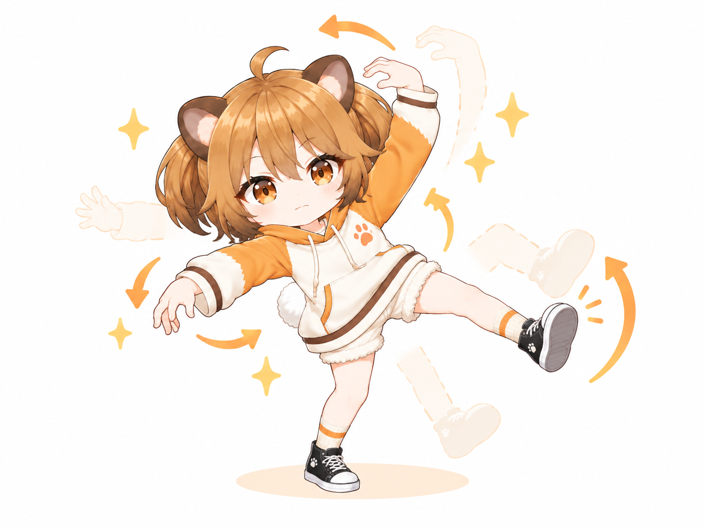

Finished VRMA files are bundled under `assets/motions/`. No conversion or generation is required after downloading Avatar Gateway.

The bundled VRMA files are provided under CC0. Attribution is not required, and use, modification, redistribution, and commercial use are unrestricted. See the [Bundled Asset Licenses](ASSET_LICENSES.en.md).

Enable motion preview buttons in Settings to play registered motions. You can also drag and drop a `.vrma` file onto the avatar in Standard view, or select `Try a VRMA`. The temporary file is played only in the browser, is not uploaded, and is forgotten on reload.

During a conversation, registered motions and expressions change automatically to match the Hermes reply.

### Editing the Motion Catalog (Optional)

Motions are registered in `config/motions.json`. The initial catalog contains 15 static poses and one animated nod.

```json
{
  "schema_version": 1,
  "generating_motion": "hands_behind_back",
  "motions": [
    {
      "name": "hands_behind_back",
      "label": "手を後ろで組む",
      "file": "手を後ろで組むポーズ.vrma",
      "prompt": "穏やかに考える、落ち着いて待つ返答",
      "playback": "auto",
      "exit_duration_seconds": 0.6,
      "enabled": true
    }
  ]
}
```

- `name`: Motion identifier. Start with a lowercase ASCII letter and use lowercase letters, digits, `_`, or `-`. `none` is reserved.
- `label`: Name shown on the preview button and playback status.
- `file`: VRMA filename under `assets/motions/` or `local-assets/motions/`. Directory paths are not allowed.
- `prompt`: Short description that helps Hermes decide when to select the motion.
- `playback`: Defaults to `auto`. `pose` holds the first frame until stopped. `animation` plays once for the file duration. `auto` treats only zero-duration or one-key-per-track files as poses.
- `exit_duration_seconds`: Return duration in seconds, from `0.1` to `5.0`, default `0.6`.
- `enabled`: Set to `false` to keep the entry while hiding it from Hermes and the preview controls.
- `generating_motion`: Motion used while Hermes generates text. Set it to `null` to disable it.

To add a bundled motion:

1. Confirm that you may use and redistribute the finished VRMA file, then place it under `assets/motions/`.
2. Add an entry to the `motions` array in `config/motions.json`.
3. Restart or automatically reload FastAPI, then refresh the browser.
4. Confirm that the preview button appears.
5. Trigger a matching reply and confirm automatic selection during speech.

Personal VRMA files can be placed under `local-assets/motions/`. A local file with the same name takes priority over a bundled file.

An invalid catalog stops only motion integration; text chat and speech continue. The screen reports the reason, and missing motion files are excluded from the choices sent to Hermes.

If a VRMA intended as a static pose returns immediately after playing, set `"playback": "pose"` for that catalog entry.

### Camera Controls (Optional)

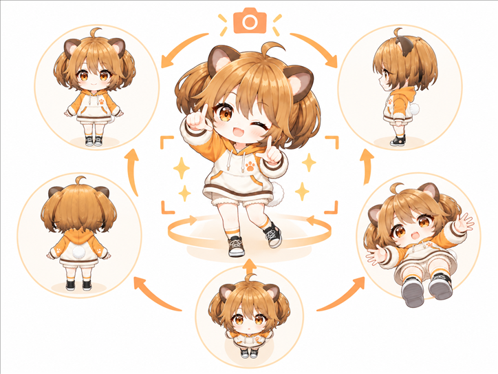

When a VRM loads, the camera is automatically positioned so that the whole body fits on screen.

```text
Left drag: move vertically or horizontally
Mouse wheel or middle drag: zoom
Right drag: rotate the camera
Touch: one finger rotates; two fingers zoom and move
```

Select `Reset camera` to return to the automatically calculated position.

### Generated Images and 90-Day Retention (Optional)

When Hermes generates an image, Avatar Gateway saves a copy under `runtime/images/` and displays it with the reply. Conversation view uses a separate image card; select an image to open the original in a new tab, or select `×` to close only the card. Standard view shows images inline with the answer.

The default retention period is 90 days. Avatar Gateway never modifies or deletes the original Hermes image.

Save any image you want to keep while it is still available. After expiration, the text remains in history but the image can no longer be displayed.

If you use Hermes `image_generate`, check the image cache in the project-root `.env`:

```env
HERMES_IMAGE_CACHE_DIR=~/.hermes/cache/generated/images
AVATAR_GATEWAY_IMAGE_RETENTION_DAYS=90
```

These values match the standard Hermes layout using `cache/generated/images`. Older Hermes versions may use `cache/images`; set the actual location used by your Hermes installation. If you changed `HERMES_HOME`, use the path under that directory. Restart the Avatar Gateway backend after changing it.

The Avatar Gateway backend must be able to access the cache as local files. If Hermes runs on another server, mount its image directory through shared storage and set `HERMES_IMAGE_CACHE_DIR` to that path. Text chat still works without a shared cache, but generated images cannot be displayed.

### Date and Time Context for Conversations (Optional)


Whenever a conversation starts, the Avatar Gateway backend sends HermesAgent the current date, time, time of day, and the time of the previous user message. This applies to text input, voice input, and avatar interactions. It does not make the avatar start conversations on its own.

The default time zone is Japan Standard Time (`Asia/Tokyo`), even when the server operating system uses UTC. To use another region, add a value such as the following to `.env`, then restart the backend:

```env
AVATAR_GATEWAY_TIMEZONE=Europe/London
```

If the setting is omitted, `Asia/Tokyo` is used. An invalid time-zone name prevents startup, so check its spelling. The server clock must also be correct.

| Phase | Local time |
| --- | --- |
| `morning` | 05:00–11:59 |
| `daytime` | 12:00–17:59 |
| `evening` | 18:00–22:59 |
| `night` | 23:00–04:59 |

The previous conversation time is also provided within the same session, allowing Hermes to respond with the passage of time in mind. A new session is treated as the first conversation.

### Viewing Hermes Skills and Toolsets (Optional)

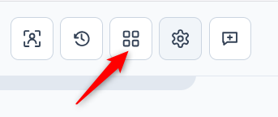

Select the four-tile icon labeled `Features` to view:

- Enabled Toolsets and the tool names they expose
- Configured Toolsets that are disabled or incomplete
- Available Skill names, categories, and descriptions

This screen is read-only. Change Skill and Toolset configuration in Hermes, then select `Reload`.

### Use from Another Device on the LAN (Optional)

For LAN access, do not use the Vite development server. Use the frontend built in the normal setup so that FastAPI serves the entire application from one origin. Add settings such as these to `.env`:

```env
AVATAR_GATEWAY_HOST=0.0.0.0
AVATAR_GATEWAY_PORT=8000
AVATAR_GATEWAY_LAN_MODE=true
AVATAR_GATEWAY_AUTH_USERNAME=avatar
AVATAR_GATEWAY_AUTH_PASSWORD=
AVATAR_GATEWAY_ALLOWED_HOSTS=192.168.1.20,avatar-gateway.local
```

`AVATAR_GATEWAY_ALLOWED_HOSTS` lists the server IP addresses or hostnames that users type into the browser, not the client device addresses. Separate multiple values with commas. `*` is not allowed.

```bash
cd frontend
npm run build
cd ../backend
.venv/bin/python -m app
```

Open an address such as `http://192.168.1.20:8000` on the other device.

Set `AVATAR_GATEWAY_AUTH_PASSWORD` to a value at least 16 characters long only when Basic authentication is required. An empty value means no authentication. With a password, the browser login protects static files, APIs, audio, and local assets, and write APIs accept only same-origin operations.

HTTP Basic authentication restricts access but does not encrypt the connection. Use this configuration only on a trusted home LAN. For an untrusted network or internet access, require an HTTPS reverse proxy or VPN. Do not expose Avatar Gateway directly to the internet.

### Use Another Hermes Profile (Optional)

A Hermes Profile keeps its persona, memory, conversation history, model, Skills, and related data separate from other Profiles. No additional setup is required when you use only the default Profile.

Avatar Gateway does not provide a Profile selector, so switch Profiles by editing `.env` in the project root. The appearance selected by `AVATAR_VRM_FILE` and the voice selected by `STYLEBERTVITS2_*` remain Avatar Gateway settings and do not change with the Hermes Profile.

Wait for the current Hermes task and speech playback to finish before switching. First list the available Profile names:

```bash
hermes profile list
```

For example, use the following values for a named Profile called `ivy` served by the shared Hermes Gateway:

```env
HERMES_BASE_URL=http://127.0.0.1:8642/p/ivy/v1
HERMES_API_KEY=API_SERVER_KEY for ivy
HERMES_IMAGE_CACHE_DIR=~/.hermes/profiles/ivy/cache/generated/images
```

Include the final `/v1` in `HERMES_BASE_URL`, and use the Profile name exactly as shown by `hermes profile list`. If each Profile has a different `API_SERVER_KEY`, update `HERMES_API_KEY` as well. Change `HERMES_IMAGE_CACHE_DIR` together with the Profile so generated images come from the correct Profile.

If Hermes uses a location other than `~/.hermes`, replace the start of the image path with the actual `HERMES_HOME`. For example, when `HERMES_HOME=/srv/hermes`, the `ivy` image directory is `/srv/hermes/profiles/ivy/cache/generated/images`.

The `/p/<profile-name>/v1` route requires `gateway.multiplex_profiles: true` on the default Hermes Gateway, and the Profile must be served by that shared Gateway. Restart Hermes Gateway after changing its Profile or multiplex settings.

After saving `.env`, restart the Avatar Gateway backend, reload the browser, and select the speech-bubble-plus icon labeled `New session` to begin a new session. Conversation history is separate for each Profile.

Check the connection at:

```bash
curl http://127.0.0.1:8000/api/health
```

If the screen reports that Hermes does not support the Capabilities API, check the following:

- `HERMES_BASE_URL` includes `/p/<profile-name>/v1`
- The capitalization and spelling of the Profile name match `hermes profile list`
- The default Hermes Gateway is running with `gateway.multiplex_profiles` enabled
- The selected Profile is included among the Profiles served by the shared Gateway
- `HERMES_API_KEY` matches the selected Profile

To return to the default Profile, restore the values shown in [Initial Configuration](#1-initial-configuration) and restart the Avatar Gateway backend.

### Start the Development Frontend (Optional)

Run the Vite development server separately from the backend only when you are developing the interface and need changes to appear immediately. It is not required for normal use.

```bash
cd frontend
npm run dev
```

In this case, open `http://127.0.0.1:5173`. Keep the backend running on port 8000 as well.

## Troubleshooting


### Cannot Connect to Hermes

- Confirm that the Hermes API Server is running at `127.0.0.1:8642`.
- Confirm that `HERMES_API_KEY` in `.env` matches the Hermes `API_SERVER_KEY`.
- Include the final `/v1` in `HERMES_BASE_URL`.

When Hermes and Avatar Gateway run on different machines, Hermes must accept connections from outside localhost. In the `.env` used by Hermes, set the following value and then restart Hermes Gateway:

```env
API_SERVER_HOST=0.0.0.0
```

`0.0.0.0` listens on every network interface. Use this setting only on a trusted LAN, and protect the service with `API_SERVER_KEY` and appropriate firewall rules.

From the machine running Avatar Gateway, connect to the Hermes health endpoint. The following IP address is an example; replace it with the address of the machine running Hermes:

```bash
curl -v http://192.168.2.168:8642/health
```

An HTTP 200 response containing `"status": "ok"` confirms that Hermes is reachable from the Avatar Gateway machine. If the connection is refused or times out, check that Hermes Gateway was restarted and verify the IP address, port, and firewall. This request verifies network reachability; it does not display the contents of the Hermes `.env` file.

Point the Avatar Gateway `.env` at the same address:

```env
HERMES_BASE_URL=http://192.168.2.168:8642/v1
```

### `Skill list API error: 502` in the Resources Screen

Some current Hermes revisions return an internal error for `GET /v1/skills`. The Avatar Gateway resources screen cannot load in this case, but normal conversations and task execution still work. Changing Avatar Gateway connection settings does not fix this Hermes-side problem.

To apply a temporary Hermes-side fix, inspect `APIServerAdapter._handle_skills` in `gateway/platforms/api_server.py`. The current `tools.skills_tool._find_all_skills` definition accepts only `skip_disabled`, so do not pass the unsupported `include_editorial` argument:

```python
skills = _sort_skills(
    _find_all_skills(skip_disabled=False)
)
```

Restart Hermes Gateway and confirm that `GET /v1/skills` succeeds, then select `Reload` in Avatar Gateway. Prefer the upstream implementation after an official fix is merged.

### Text Works but Speech Does Not

- Confirm that Style-Bert-VITS2 is running at `127.0.0.1:5000`.
- The browser error includes the Style-Bert-VITS2 HTTP status and a response summary.
- Temporarily set `STYLEBERTVITS2_ENABLED=false` to test text chat and VRM display first.
- Increase `STYLEBERTVITS2_CHUNK_MIN_CHARS` when speech is split into too many short pieces.
- Reduce `STYLEBERTVITS2_CHUNK_MAX_CHARS` when synthesis starts too slowly on long text. Start around 80 to 120 characters.

### The VRM Is Not Displayed

- Confirm that the filename in `AVATAR_VRM_FILE` exists under `assets/vrm/` or `local-assets/vrm/`.
- Confirm that `vrm_available` is `true` in `/api/health`.
- Use a real VRM 0.x or 1.0 file, not a file with only its extension renamed.
- Large models may take longer to load initially.

### The Microphone Cannot Be Enabled

- For local faster-whisper, follow [microphone setup](#set-up-faster-whisper) to download a model. An OpenAI-compatible API does not need this download.
- Keep `FASTER_WHISPER_LOCAL_FILES_ONLY=true` so normal startup cannot download files unexpectedly.
- Set `FASTER_WHISPER_ENABLED=false` when microphone input is not needed.
- For HTTP access from another device, see [browser settings](#using-the-microphone-over-http-on-a-lan).

### Using the Microphone over HTTP on a LAN

Use the following settings only on a trusted home LAN. Replace the example address with the address you actually use to open Avatar Gateway.

#### Shared Chromium Settings for Microphone and Screen Sharing

In Chrome or another Chromium-based browser:

1. Enter `chrome://flags/#unsafely-treat-insecure-origin-as-secure` in the address bar.
2. Change `Insecure origins treated as secure` to `Enabled`.
3. Enter the Avatar Gateway address, including its port number.

   ```text
   http://192.168.1.20:8000
   ```

   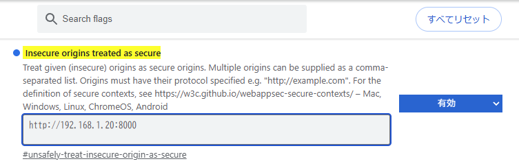

4. Restart the browser.
5. Open Avatar Gateway again and allow microphone access.

This setting is shared by microphone access and screen sharing. If you already configured it for the microphone and restarted the browser, no additional screen-sharing setting is needed. See [Chromium’s explanation](https://www.chromium.org/Home/chromium-security/deprecating-powerful-features-on-insecure-origins/).

#### Firefox Microphone Settings

In Firefox:

1. Enter `about:config` in the address bar.
2. Accept the warning to open the advanced settings.
3. Find the following two settings and change both to `true`.

   ```text
   media.devices.insecure.enabled
   media.getusermedia.insecure.enabled
   ```

   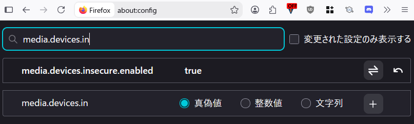

   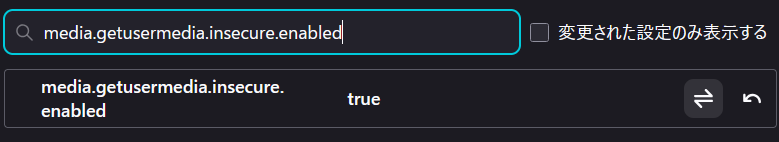

4. Restart Firefox.
5. Open Avatar Gateway again and allow microphone access.

These settings weaken browser security restrictions. When they are no longer needed, restore the Chrome or Chromium setting to `Default` and both Firefox settings to `false`.

Firefox screen sharing requires a separate host exception. See [Firefox screen sharing settings](#using-firefox-screen-sharing-over-http-on-a-lan).

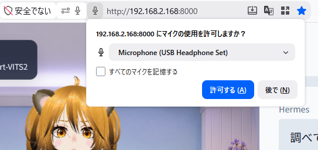

### Using Firefox Screen Sharing over HTTP on a LAN

Use these steps when opening Avatar Gateway over HTTP in Firefox on a trusted home LAN. They register the host in Firefox's secure-context allowlist.

1. Enter `about:config` in Firefox's address bar.
2. Accept the warning to open the advanced settings.
3. Search for `dom.securecontext.allowlist`. Edit the existing entry, or select **String** and the **＋** button to create it if it is missing.
4. Save **only the IP address or hostname** used to open Avatar Gateway. For example, if the address is `http://192.168.1.20:8000`, enter:

   ```text
   192.168.1.20
   ```

   Omit `http://`, `:8000`, and the trailing `/`. If other hosts are already listed, preserve them and add this host separated by a comma.
5. Reload the Avatar Gateway page.
6. Select **Share screen** and choose a screen or window. In Conversation view, select **＋** in the bottom controls to reveal **Share screen**.

Setting the microphone preferences `media.devices.insecure.enabled` and `media.getusermedia.insecure.enabled` to `true` is not sufficient to enable screen sharing. Register the host as described above. When the exception is no longer needed, remove the host you added from `dom.securecontext.allowlist`.

See [Mozilla's secure-context allowlist explanation](https://bugzilla.mozilla.org/show_bug.cgi?id=1818097#c6) and [the secure-context requirement in Firefox's screen sharing API](https://searchfox.org/firefox-main/source/dom/webidl/MediaDevices.webidl#75) for the basis of these instructions.

### No Speech Audio in Firefox

Start the first playback by sending a message from the screen so the browser can allow audio. If Firefox still blocks it, allow audio autoplay from the permission control near the address bar.

## Security

- Only the backend reads Hermes and Style-Bert-VITS2 credentials.
- The default server listens only on `127.0.0.1` and is not exposed to the LAN.
- Product assets are served only from `assets/`. User assets are served only when explicitly placed under this project’s `local-assets/`.
- Generated images are served only after they are copied from an official Hermes `image_generate` result into `runtime/images/`.
- LAN mode requires an explicit allowed-host list. Basic authentication is optional for environments that need it.
- The backend refuses an external listening address unless LAN mode is explicitly enabled.
- LAN HTTP traffic is not encrypted. Use HTTPS or a VPN on untrusted networks.

## Major Open-Source Software

Avatar Gateway uses the following open-source software:

- [Hermes Agent](https://github.com/NousResearch/hermes-agent): external service for conversations and tool execution
- [React](https://github.com/facebook/react), [three.js](https://github.com/mrdoob/three.js), and [@pixiv/three-vrm](https://github.com/pixiv/three-vrm): interface and VRM avatar rendering
- [FastAPI](https://github.com/fastapi/fastapi): backend API
- [faster-whisper](https://github.com/SYSTRAN/faster-whisper): optional speech recognition
- [Style-Bert-VITS2](https://github.com/litagin02/Style-Bert-VITS2): optional external speech synthesis service

Each project remains subject to its own license. See the [Third-Party Software Notices](THIRD_PARTY_NOTICES.md) for a summary of their roles and licenses.

## Licenses

- Avatar Gateway source code: [MIT License](LICENSE)
- Bundled VRMA files and background images: [CC0 1.0](ASSET_LICENSES.en.md)
- `はむ子.vrm`: [VRM model-specific terms of use](docs/character_model_license.md), currently available in Japanese

Models, motions, and images added under `local-assets/` remain subject to the terms set by their respective creators.
